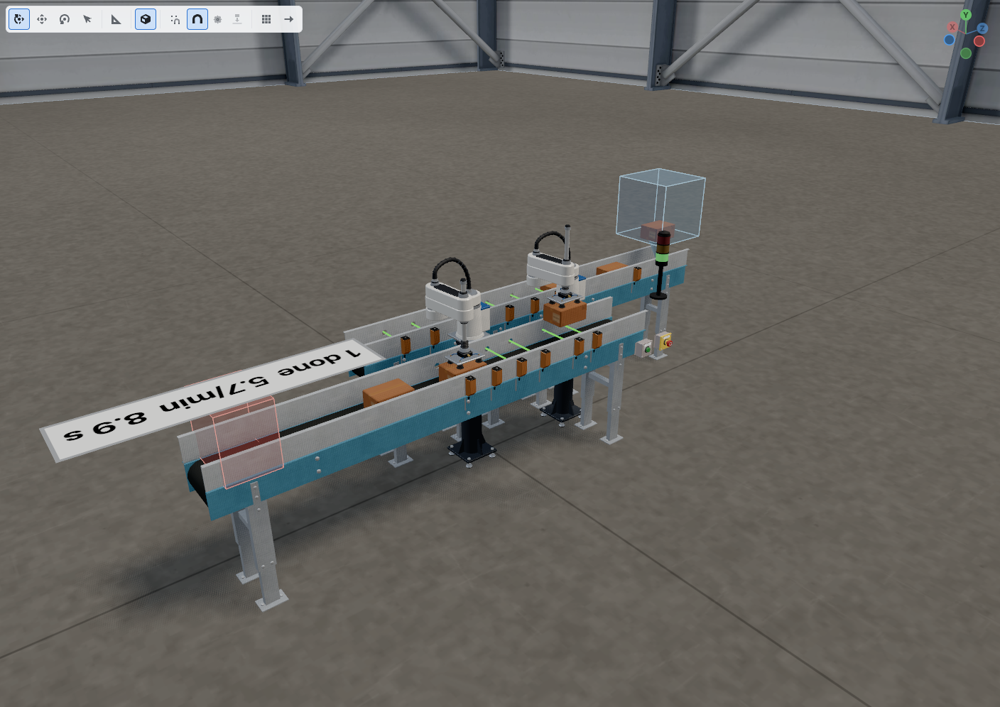
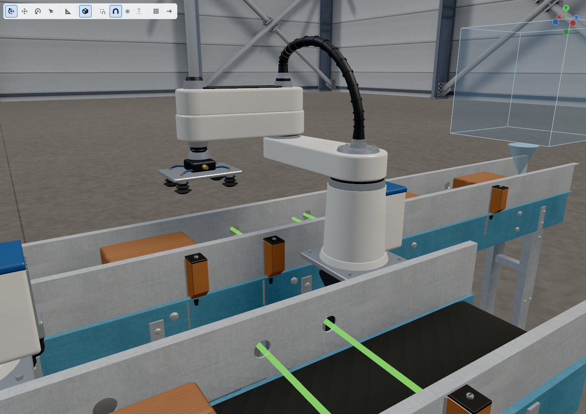

# Dual-SCARA parallel transfer cell in Open Industry Project

[](https://github.com/sergiudanstan/scara-cell-oip/actions/workflows/ci.yml)
[](https://github.com/sergiudanstan/scara-cell-oip/actions/workflows/codeql.yml)
[](https://scorecard.dev/viewer/?uri=github.com/sergiudanstan/scara-cell-oip)
[](LICENSE)

Two floor-pedestal 4-axis SCARA robots (600 mm reach, 6 kg class) transfer 3 kg cartons in parallel from a two-station
infeed line to a shared outfeed conveyor. The cell is built in [Open Industry Project](https://openindustryproject.org)
(OIP), a free, MIT-licensed browser simulator with Jolt physics and a built-in IEC 61131-3 PLC. The SCARA is a custom
OIP rig part (`parts/scara.transfer-robot`), placed twice (`robot1` and `robot2`) and driven by an ST program through
two independent handshakes.



It is the sister of [duopod-cell-oip](https://github.com/sergiudanstan/duopod-cell-oip) and
[delta-cell-oip](https://github.com/sergiudanstan/delta-cell-oip), redesigned for dual-robot parallel picking with
pass-through station routing and outfeed merge protection.

## Open it

- **Live:** [sergiudanstan.github.io/scara-cell-oip](https://sergiudanstan.github.io/scara-cell-oip/). The OIP editor
  opens with the Dual-SCARA cell loaded and already running. Stop, E-STOP, START, edit the PLC program or run the
  project tests right there. Built by `tools/build_site.sh` and served from the `gh-pages` branch.
- **In the official app:** go to [openindustryproject.org/app](https://openindustryproject.org/app), choose **Import Project**
  and pick [`dist/scara-cell.scene.json`](dist/scara-cell.scene.json). Press Play, then the green START button on the
  operator panel.
- **As a project folder:** this repository *is* the OIP project folder (`project.json`, `scene.json`, `plc/`, `parts/`,
  `tests/`). The OIP desktop app opens it directly.

## What is in the cell

| Component | Description |
|---|---|
| Infeed A1 | accumulation belt at `x = +0.35 m`, 0.40 m/s, 220 mm guides |
| Pick belts A2 & A3 | Station 1 (`z = +0.45 m`) and Station 2 (`z = -0.45 m`) pick belts, 0.65 m/s |
| Escapement & routing | `bladeQ` at the A1/A2 junction + pass-through `bladeS1` at Station 1 (drops to route cartons to Station 2) + fixed `endStop2` at Station 2 |
| Outfeed B | shared outfeed belt at `x = -0.35 m`, 0.45 m/s, ending in a despawner that counts deliveries (`Delivered`) |
| Cartons | 250 × 180 × 120 mm, 3 kg, from a box spawner gated by the PLC (`EyeFull` for 1 s) |
| Photo-eyes | `EyeFull`, `EyeHead`, `EyeGate1`, `EyeZone1`, `EyeStop1` (Station 1), `EyeZone2`, `EyeStop2` (Station 2), `EyeB1a`/`EyeB1b` (SCARA 1 drop zone), `EyeB2a`..`EyeB2d` (SCARA 2 approach & drop zone) |
| Operator | E-STOP (normally closed, `EStopOk`), START (`StartPB`), stack light (`StackLight`) |
| Robots | `robot1` (`z = +0.75 m`) and `robot2` (`z = -0.15 m`), instances of `parts/scara.transfer-robot` (Draco GLB, 0.07 MB part) |

### The 4-axis SCARA part (`parts/scara.transfer-robot`)



The model (`tools/model.mjs`, our own procedural geometry, no vendor CAD) consists of a bolted steel floor pedestal
with 4 adjustable levelling feet and welded triangular gusset ribs, a filleted cast base column with rear cooling fins
and Harting multi-pin connector hood (cable routed into the pedestal flange gland), a contoured cast J1 shoulder arm
(`L1 = 325 mm`) with recessed side pockets, a J2 elbow turret and forearm (`L2 = 275 mm`, total reach `600 mm`), a
corrugated umbilical conduit anchored into rotary strain-relief glands on both the `J1` and `J2` axes (never detaching
at any joint angle), a J3 vertical ball-screw spline shaft (`250 mm` stroke) with convoluted rubber bellows boot, and a
J4 wrist flange carrying a 4-cup multi-fold bellows vacuum manifold with full pneumatic tubing to every fitting.

Every tick, `behavior.js` solves the 4-DOF analytical SCARA inverse kinematics (`ik(tcp)`):
- `J1` and `J2` position the quill axis over `(x, z)` using the elbow-right branch (staying clear of the column as the
  TCP travels straight across between `x = +350 mm` and `x = -350 mm` at `z = -300 mm` relative to each pedestal).
- `J3` translates the spline shaft vertically to `height`.
- `J4 = -(J1 + J2)` counter-rotates the wrist so the rectangular vacuum manifold stays aligned with the conveyors
  throughout the swing.

| Tag parameter (`robot1` / `robot2`) | Dir | Meaning |
|---|---|---|
| `R1Cmd` / `R2Cmd` | in | point row: 1 ready, 2 pick, 3 place |
| `R1Execute` / `R2Execute` | in | rising edge starts the move (held until `Busy`) |
| `R1Done`, `R1Busy`, `R1Point` / `R2*` | out | standing on a point / moving / current point row |
| `R1Vacuum`, `R1VacOk` / `R2*` | in / out | vacuum command (latched at standstill) / load held |
| `R1Enable` / `R2Enable` | in | low holds the robot motion where it is |
| `R1X`, `R1Z` / `R2X`, `R2Z` | out | actual TCP across the belts and height above belt top (mm) |

### The PLC program (`plc/program.st`)

- **Dual-station escapement & pass-through routing.** `BladeUp` opens only when Station 1 is empty, no carton is still
  transiting through Station 1 to Station 2, SCARA 1 is clear of Belt A, and the queue head has settled at `EyeHead`.
  When Station 2 is empty and SCARA 2 is clear, `BladeS1Up` drops so the released carton passes straight through
  Station 1 onto `beltA3` for SCARA 2; once `EyeZone2` sees it and `EyeStop1` is clear, `BladeS1Up` rises again so the
  next released carton stops at Station 1 for SCARA 1.
- **Parallel SCARA cycles & outfeed merge.** Each SCARA independently runs `ready → pick → vacuum → wait drop zone clear
  → place → release → ready`. SCARA 2 monitors upstream approach photo-eyes (`EyeB2a`..`EyeB2d`) on Belt B so it never
  drops a carton onto one arriving from SCARA 1.
- **Supervision.** `ColumnAlarm` latches if `BladeUp` is ever open while SCARA 1 is low over the infeed column.
- **Safety (ISO 13850).** Pressing E-STOP drops `Running`, every belt, the feed, `R1Enable` and `R2Enable`. Both SCARAs
  freeze in place and keep vacuum so carried cartons are never dropped. Releasing E-STOP restarts nothing (amber light);
  pressing START resumes operation (green light).

## Tests

Run from a checkout of OIP:

```sh
cd open-industry-project
P=/path/to/scara-cell-oip
npm run check-part -- $P/parts/scara.transfer-robot
npm run validate-project -- $P --strict
npm run check-st -- $P/plc
npm run check-wiring -- $P --strict
npm run check-layout -- $P
npm run test-project -- $P
OIP=$PWD $P/tools/perturb.sh     # the tests must FAIL on mutated programs
node $P/tools/check_kin.mjs      # 4-DOF SCARA kinematics closure and joint range
```

## Rebuilding

| Script | Does |
|---|---|
| `tools/make_part.sh` | `model.mjs` (procedural SCARA GLB) → weld + Draco → `build_part.mjs` → `check-part` |
| `tools/check_kin.mjs` | verify 0.000 nm forward/inverse closure and J1/J2 joint margins across 3012 poses |
| `tools/build_scene.sh` | lay out the dual-SCARA cell with OIP's `add-part`, bind `plc/` and `tests/` |
| `tools/scene_file.mjs` | write `dist/scara-cell.scene.json`, the single-file scene for Import Project |
| `tools/build_site.sh` | build the GitHub Pages site (`_build/site`) with auto-load of the cell |

## Development

CI (`.github/workflows/ci.yml`) runs on every push and pull request, against the pinned OIP commit
[`7ed2b7d`](https://github.com/Open-Industry-Project/Open-Industry-Project/commit/7ed2b7dbf01835365ba3432bbdd84d933a843dde):

1. **OIP project checks and tests**: `check-part`, `validate-project --strict`, `check-st`, `check-wiring --strict`,
   `check-layout`, `tools/check_kin.mjs`, the three project tests, and `tools/perturb.sh` (the tests must fail on mutated programs).
2. **Published site smoke test**: builds the GitHub Pages site with `tools/build_site.sh`, opens it in headless Chrome
   (`tests/site-smoke.mjs`) and fails unless the cell loads, the PLC runs and the robot picks a carton, with no page
   error or failed request.
3. **Security audit**: `pip-audit` on the hash-pinned CI toolchain, `npm audit` on the test tooling, and `zizmor` on
   the workflows. CodeQL and OpenSSF Scorecard run as their own workflows.

To run the site test locally (needs Google Chrome; set `PW_CHANNEL=chromium` for Playwright's Chromium):

```sh
npm ci --ignore-scripts
OIP=/path/to/open-industry-project tools/build_site.sh _build/site
node tests/site-smoke.mjs _build/site
```

See [CONTRIBUTING.md](CONTRIBUTING.md), [SECURITY.md](SECURITY.md) and [CHANGELOG.md](CHANGELOG.md).

## Licences and disclaimer

- `parts/oip.*` are copies of OIP built-in parts, MIT © Automation Standard LLC and Contributors, see
  [`parts/LICENSE-OIP`](parts/LICENSE-OIP).
- The SCARA robot model is our own procedural model. No vendor CAD is used.
